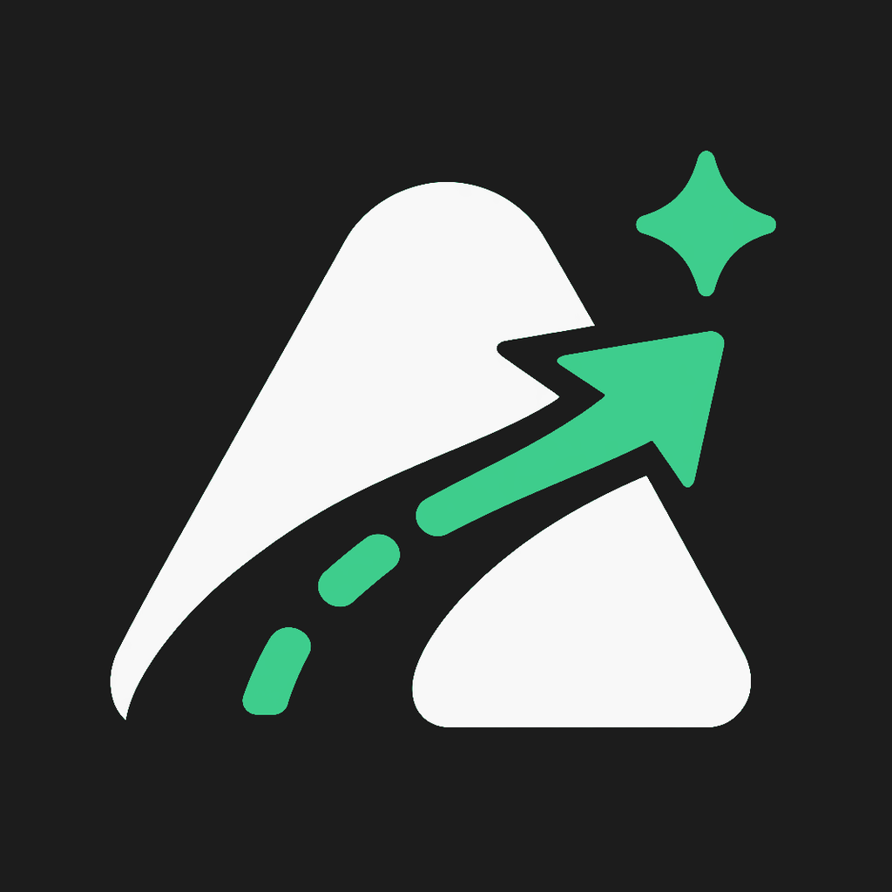
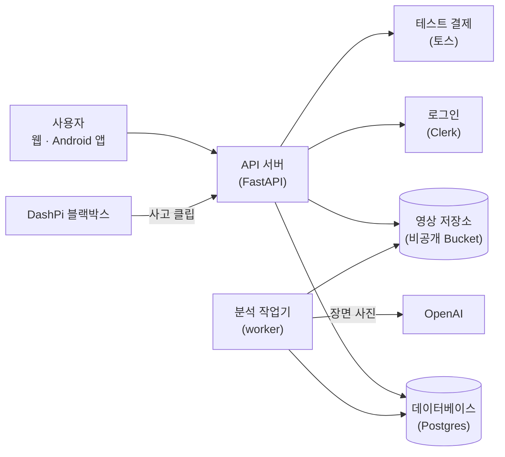

<p align="center">
  
</p>

<h1 align="center">AIGO</h1>

<p align="center">
  <strong>사고를 판정하는 AI가 아니라, 사고 대응력을 높이는 AI.</strong><br />
  블랙박스 사고 영상을 올리면 충돌 장면을 찾고, 근거 장면과 과실 기준이 담긴 레포트를 만들어 주는 서비스
</p>

<p align="center">
  <a href="#why">서비스 소개</a> ·
  <a href="#try">써 보기</a> ·
  <a href="#status">지금 어디까지</a> ·
  <a href="#architecture">구조</a> ·
  <a href="#together">함께 만드는 방식</a> ·
  <a href="#docs">문서 길잡이</a>
</p>

> **경기과학기술대학교 디자인공학과 캡스톤 프로젝트입니다.** 가상 서비스라서 실제 상품을 팔지 않고, 결제는 토스 테스트 환경에서만 동작합니다(돈이 나가지 않습니다).
>
> AIGO의 결과는 **영상 기반 AI 추정이며 법적 판단이 아닙니다.** 분석 품질은 아직 목표에 못 미칩니다. 자세한 수치는 [지금 어디까지](#status)에 있습니다.

<a id="why"></a>

## 우리가 만드는 서비스

교통사고 직후에는 당황해서 무엇을 확인하고 무엇을 남겨야 할지 놓치기 쉽습니다. 블랙박스 영상이 있어도 몇 초 사이에 무슨 일이 있었는지 다시 보기 어렵습니다.

AIGO는 사고 영상을 올리면 **충돌이 일어난 순간을 찾고, 영상에서 보이는 사실을 시각과 함께 정리하고, 손해보험협회 과실비율 기준에 맞춰 예상 과실 범위를 보여 줍니다.** 레포트의 근거 시각을 누르면 그 장면으로 영상이 이동합니다.

AIGO는 서비스 이름이고, **DashPi**는 AIGO가 판매하는 블랙박스 상품 이름입니다. DashPi를 쓰는 사람도, 다른 블랙박스를 쓰는 사람도 같은 화면과 같은 레포트를 받습니다.

### 우리가 지키는 원칙

| 원칙 | 서비스에서 지키는 방식 |
|---|---|
| **AI는 사실을 정리하고, 숫자는 기준이 낸다** | AI는 영상에서 보이는 사실을 적고 기준 도표를 고르기만 합니다. 과실 범위와 신뢰도는 코드가 계산합니다. |
| **모든 주장에는 근거 장면이 있다** | 레포트의 문장마다 영상 시각을 붙입니다. 시각이 없는 주장은 코드가 버립니다. |
| **모르면 모른다고 한다** | 영상으로 알 수 없는 것(음주, 무면허 등)은 "확인할 수 없음"으로 둡니다. 맞는 기준이 없으면 과실비율을 내지 않습니다. |
| **사고가 아닌 영상에 지어내지 않는다** | 사고가 없는 영상에 과실을 표시하면 실패로 봅니다. 지금까지 0건입니다. |
| **사고 현장에서는 기다리게 하지 않는다** | 앱의 사고 현장 모드는 로그인과 인터넷 없이 바로 열립니다. |
| **영상은 조심해서 다룬다** | 올리기 전에 동의를 받고, 영상은 비공개로 보관하고, 지우면 파일까지 지웁니다. |

근거: [분석 원칙](docs/adr/0011-analysis-principles.md) · [과실 기준](docs/adr/0012-fault-charts.md) · [영상과 개인정보](docs/adr/0015-privacy-videos.md) · [모바일 앱](docs/adr/0017-mobile-app.md)

### 서비스 흐름

| 단계 | 사용자가 하는 일 | AIGO가 하는 일 |
|---|---|---|
| **사고 직후** | 앱의 사고 현장 모드를 엽니다. | 체크리스트, 112·119·보험사 전화, 시각·위치가 붙은 현장 사진을 제공합니다. |
| **영상 올리기** | 웹이나 앱에서 영상을 고르고 동의합니다. DashPi는 사고 버튼을 누르면 자동으로 올립니다. | 영상을 비공개 저장소에 받습니다. |
| **분석** | 기다립니다. 화면을 닫아도 됩니다. | 충돌 후보를 찾고, 그 장면을 AI가 관찰하고, 기준 도표와 맞춰 봅니다. 진행 단계를 화면에 보여 줍니다. |
| **레포트** | 결과를 읽고 근거 장면을 눌러 확인합니다. | 요약, 근거 타임라인, 예상 과실 범위, 관련 법규·판례, 지금 할 일을 보여 줍니다. |
| **공유** | PDF로 저장하거나 보험사·가족에게 보냅니다. | 앱에서 레포트 PDF를 만듭니다. |

<a id="try"></a>

## 써 보기

| 어디서 | 주소 |
|---|---|
| **웹** | https://aigo.up.railway.app |
| **Android 앱** | [최신 APK 내려받기](https://github.com/jcmaker/aigo/releases/latest) · 처음 설치하면 "출처를 알 수 없는 앱 설치"를 허용해야 합니다 |
| **iPhone** | 아직 지원하지 않습니다 |

- 이메일로 가입하면 바로 쓸 수 있습니다. 상품 구매는 테스트 결제라서 실제로 청구되지 않습니다.
- 영상은 mp4, mov, webm, avi 형식, 200MB와 2분 이하만 올릴 수 있습니다. 한 사람당 하루 5건까지 분석합니다. ([이용 한도](docs/adr/0016-usage-limits.md))
- 다른 사람의 얼굴이나 번호판이 담긴 영상은 공개된 곳에 올리지 마세요.

<a id="status"></a>

## 지금 어디까지 만들었나요?

**2026-11-09 기준 · `main` 브랜치**

| 기능 | 상태 | 어떻게 확인했나 |
|---|---|---|
| 랜딩, 상품 2종, 테스트 결제, 주문 내역 | 운영 중 | 운영 주소에서 가입 → 결제 → 분석 전체 시나리오 자동 테스트 |
| 이메일 가입·로그인, 탈퇴 | 운영 중 | 위 시나리오와 API 테스트 |
| 소셜 로그인(Google, Apple, Facebook) | 버튼과 연결은 있음 | 실제 계정으로 끝까지 로그인하는 확인은 남음 |
| 영상 업로드, 분석 진행 표시, 레포트, 근거 장면 이동 | 운영 중 | 위 시나리오(실제 AI 호출 포함) |
| 충돌 추정(소리와 흔들림으로 충돌을 알아챔) | 운영 중 | 평가 영상으로 측정. 아래 표 참고 |
| 관련 법규·참고 판례 표시 | 운영 중 | 앱 개발 빌드에서 화면 확인. 운영 웹 화면 확인은 남음 |
| Android 앱(현장 모드, 구간 자르기, 공유받기, PDF) | APK v0.3.2 배포 | 에뮬레이터에서 화면 확인. iOS는 미지원 |
| 분석 완료 알림 | 코드 있음 | 실제 알림 수신은 알림 서비스(EAS·FCM) 설정 뒤 확인 |
| DashPi 블랙박스 자동 업로드 | 서버·웹·앱 쪽 구현 | 실제 기기에서의 확인 기록은 이 저장소에 없음 |
| 실제 결제, 배송, 스토어 출시 | 하지 않음 | 캡스톤 범위 밖 |

### 분석 품질

**아직 목표에 못 미칩니다.** 아래 값은 팀이 확인하기 전의 초안 정답으로 잰 결과입니다(2026-11-08, 평가 영상 36개 중 25개 채점). 표본이 작아서 참고용입니다.

| 지표 | 목표 | 현재 |
|------|--------|------|
| 충돌 시각을 1초 이내로 맞힘 | 80% | 7/18 (이전 3/18) |
| 맞는 과실 기준 도표를 고름 | 70% | 1/6 |
| 정답 과실이 예상 범위 안에 있음 | 70% | 0/5 |
| 사고 없는 영상에 과실을 표시함 | 0건 | 0/7 |
| 근거 시각이 실제 장면과 맞음 | 90% | 38/39 (97%, 이 중 26개는 AI 판정이라 사람 확인 전) |

접촉 장면이 화면에 안 보여도 충돌음과 화면 흔들림이 함께 크게 나타나면 "충돌 추정"으로 표시합니다. 이것으로 충돌 시각은 좋아졌지만 도표 선택과 과실 범위는 거의 그대로입니다. 자세한 기록: [분석 품질 문서](docs/analysis-quality.md) · [충돌 추정 결정](docs/adr/0013-collision-estimate.md)

<a id="architecture"></a>

## 어떻게 구성했나요?



- 웹과 앱은 같은 API 서버를 씁니다. 웹은 그 API의 첫 번째 사용자일 뿐이라, 앱도 똑같은 기능을 씁니다.
- 영상 분석은 오래 걸려서 API 서버와 따로 도는 **분석 작업기(worker)**가 맡습니다. 분석 품질을 고치면 웹과 앱이 함께 좋아집니다.
- 영상은 서버를 거치지 않고 비공개 저장소에 바로 올라가고, 볼 때는 1시간짜리 임시 주소로만 엽니다.

| 영역 | 선택 | 이유 |
|---|---|---|
| 운영 | Railway(싱가포르) | 서비스 여러 개와 데이터베이스, 저장소를 한곳에서 운영합니다. [ADR 0007](docs/adr/0007-stack.md) |
| API와 분석 | Python, FastAPI | 영상 처리(FFmpeg, OpenCV, YOLO)와 같은 언어로 씁니다. |
| 웹 | Next.js, TypeScript, Tailwind | [웹 디자인](docs/adr/0020-web-design.md) |
| 앱 | React Native(Expo) | iOS와 Android를 한 코드로 만듭니다. [ADR 0017](docs/adr/0017-mobile-app.md) |
| 로그인 | Clerk | 화면은 직접 디자인하고 인증만 맡깁니다. [ADR 0009](docs/adr/0009-auth-clerk.md) |
| 결제 | 토스페이먼츠 테스트 | 금액은 서버가 계산합니다. [ADR 0010](docs/adr/0010-payments-toss-test.md) |
| 분석 모델 | OpenAI | 장면 관찰과 기준 선택에만 씁니다. 숫자는 코드가 냅니다. [ADR 0011](docs/adr/0011-analysis-principles.md) |
| 과실 기준 | 과실비율정보포털 도표 24개 | 공신력 있는 공개 기준입니다. [ADR 0012](docs/adr/0012-fault-charts.md) |

```text
apps/
  api/     API 서버, 분석 작업기, 품질 평가 도구 (Python)   ← 관리자만 수정
  web/     웹사이트 (Next.js)
  app/     모바일 앱 (Expo)
docs/
  adr/     결정 기록: 무엇을, 왜, 누가 정했는지
  superpowers/  설계 문서와 구현 계획
.github/   자동 검사(CI)와 PR 양식                      ← 관리자만 수정
```

<a id="together"></a>

## 함께 만드는 방식

팀원 누구나 GitHub 웹에서 문구, 맞춤법, 문서를 고쳐 참여할 수 있습니다. 개발 도구가 없어도 됩니다. **처음이라면 [참여 안내(CONTRIBUTING.md)](CONTRIBUTING.md)부터 읽어 주세요.**

- **바꿀 때는 이유와 작업자를 남깁니다.** PR에 배경, 할 일, 한 일, 검증, 작업자를 쓰고, 결정 기록(ADR)을 하나 추가합니다. 관리자 조준형의 요청입니다. [ADR 0001](docs/adr/0001-record-decisions.md) · [PR 쓰는 법](CONTRIBUTING.md#pr-쓰는-법)
- **백엔드(`apps/api`)는 관리자만 고칩니다.** 인증, 결제, 분석, 데이터베이스가 있어서 잘못 고치면 되돌리기 어렵습니다. [ADR 0003](docs/adr/0003-api-owner-only.md)
- **비밀값은 올리지 않습니다.** 키, 비밀번호, `.env` 파일이 들어가면 자동 검사가 막고 PR에 없애 달라는 댓글이 달립니다. [ADR 0005](docs/adr/0005-secret-scan.md)
- **브랜치는 `dev`와 `main` 둘입니다.** PR은 `dev`로 엽니다. 확인이 끝난 `dev`를 관리자가 `main`에 반영하면 운영 사이트에 자동으로 배포됩니다. 머지는 관리자만 합니다. [ADR 0002](docs/adr/0002-branches-and-ci.md) · [ADR 0022](docs/adr/0022-auto-deploy.md)
- **AI 도구(Claude Code 등)를 써도 됩니다.** 도구가 [AGENTS.md](AGENTS.md)를 읽고 작업 전에 이유와 작업자를 먼저 묻습니다.

PR을 열면 자동 검사 5개가 돕니다. 모두 초록색이어야 머지할 수 있습니다.

| 검사 | 확인하는 것 |
|---|---|
| API 테스트 | 서버 코드가 깨지지 않았는지 |
| 웹 테스트·빌드 | 웹사이트가 문제없이 만들어지는지 |
| 앱 검사 | 앱 코드에 오류가 없는지 |
| PR 가드레일 | PR 본문과 ADR을 채웠는지, 고치면 안 되는 곳을 고치지 않았는지 |
| 비밀값 검사 | 키·비밀번호·비밀 파일이 들어가지 않았는지 |

<details>
<summary><strong>개발자용</strong> 로컬 실행 · 테스트 · 환경변수 · 배포 · 앱 릴리즈</summary>

### 로컬 실행

Python 3.12(uv), Node 22(pnpm), ffmpeg, Postgres, S3 호환 저장소가 필요합니다.

```bash
# 저장소: 실제 Bucket 대신 moto 서버를 쓸 수 있다. 버킷을 만들고 CORS(PUT, GET)를 열어 둔다.
cd apps/api
uv run --with 'moto[server]' moto_server -p 9100

# API와 worker: apps/api/.env.example을 .env로 복사해 값을 채운다. DATABASE_URL은 postgresql+psycopg:// 형식이다.
uv run alembic upgrade head && uv run python -m app.seed
uv run uvicorn app.main:create_app --factory --port 8000
uv run python -m app.worker

# 웹: apps/web/.env.example을 .env.local로 복사해 값을 채운다.
cd apps/web
pnpm install && pnpm dev --port 3100
```

앱은 네이티브 모듈을 써서 Expo Go가 아니라 개발 빌드가 필요합니다.

```bash
cd apps/app
cp .env.example .env.local   # 공개 키와 API 주소를 채운다.
pnpm install
pnpm android                 # Android SDK, JDK 17 필요. 개발 빌드를 설치한다.
npx expo start --dev-client
```

- 네이티브 패키지를 추가한 뒤에는 `rm -rf android`로 지우고 다시 빌드합니다.
- 앱 디자인 시스템: 색·간격·글자는 `src/theme.ts`, 공용 부품은 `src/components/ui/`. 화면은 이 둘만 쓰고 색 값을 직접 적지 않습니다. [ADR 0018](docs/adr/0018-app-design.md)
- 로고·아이콘·스플래시는 `assets/brand/source` 원본에서 만듭니다: `cd apps/app && uv run --with numpy --with pillow python -I scripts/brand.py`

### 테스트

```bash
cd apps/api && uv run pytest          # 느린 YOLO 테스트 제외: -m 'not model'
cd apps/web && pnpm vitest run && pnpm build
cd apps/app && pnpm exec tsc --noEmit && pnpm test

# 전체 시나리오. 창을 띄운 Chrome으로 돌고, 실제 OpenAI를 호출한다. 사고 장면이 있는 클립을 쓴다.
cd apps/web && E2E_VIDEO=<영상 경로> BASE_URL=<웹 주소> pnpm playwright test e2e/journey.spec.ts

# 분석 품질 평가 (OpenAI 비용이 든다. --budget으로 상한을 둔다)
cd apps/api && DATABASE_URL=postgresql+psycopg:///dashpi_test uv run python -m app.evaluate --videos eval/videos --draft --budget 20
```

- CI(`.github/workflows/ci.yml`)는 위 세 줄을 돌립니다. 느린 YOLO 테스트와 e2e는 CI에서 돌리지 않고, 비밀값을 쓰지 않습니다.
- 분석 품질 작업은 에뮬레이터 없이 평가 도구, pytest, 웹·API로 확인합니다. [ADR 0019](docs/adr/0019-quality-testing.md)

API 응답을 바꾸면 웹·앱 타입을 다시 만듭니다. [ADR 0008](docs/adr/0008-api-contract.md)

```bash
cd apps/web && TOSS_SECRET_KEY=test_x DATABASE_URL=postgresql:///dashpi_test \
  uv run --project ../api python ../api/scripts/dump_openapi.py && pnpm gen:api
```

### 환경변수

api와 worker (`apps/api/.env.example`)

| 이름 | 설명 |
|------|------|
| `DATABASE_URL` | `postgresql+psycopg://...` |
| `S3_ENDPOINT_URL`, `S3_BUCKET`, `S3_REGION`, `S3_ACCESS_KEY_ID`, `S3_SECRET_ACCESS_KEY` | 비공개 Bucket |
| `S3_ADDRESSING_STYLE` | Railway Bucket은 `virtual`(path 주소에는 CORS 규칙이 적용되지 않는다), 로컬 moto는 기본값 `path` |
| `CLERK_SECRET_KEY`, `CLERK_JWT_KEY` | Clerk 토큰 검증 |
| `CLERK_AUTHORIZED_PARTIES` | CORS와 Clerk 토큰이 함께 쓰는 웹 주소 JSON 배열. 비우면 `WEB_ORIGIN` 하나. 도메인을 추가하면 여기와 Bucket CORS에 함께 넣는다 |
| `WEB_ORIGIN` | 웹 주소(CORS) |
| `TOSS_SECRET_KEY` | `test_`로 시작하지 않으면 서버가 시작되지 않는다 |
| `OPENAI_API_KEY`, `OPENAI_MODEL`, `OPENAI_REASONING_EFFORT` | 분석 모델 |
| `MAX_VIDEO_BYTES`, `MAX_VIDEO_SECONDS`, `USER_DAILY_LIMIT`, `GLOBAL_DAILY_LIMIT` | 영상과 하루 한도 |

web (`apps/web/.env.example`)

| 이름 | 설명 |
|------|------|
| `NEXT_PUBLIC_API_URL` | API 주소. 빌드 때 번들에 들어간다 |
| `NEXT_PUBLIC_CLERK_PUBLISHABLE_KEY` | 빌드 때 번들에 들어간다 |
| `NEXT_PUBLIC_TOSS_CLIENT_KEY` | `test_gck_` 테스트 키. 빌드 때 번들에 들어간다 |
| `CLERK_SECRET_KEY` | 서버 쪽 Clerk |

실제 값은 저장소에 올리지 않습니다. `.env.example`에는 빈 값만 둡니다.

### DashPi 업로드 키

DashPi는 화면 로그인을 할 수 없어서 계정에 묶인 Clerk API Key를 씁니다. [ADR 0021](docs/adr/0021-dashpi-upload.md)

- Clerk 대시보드 Configure → Developers → API keys에서 기능을 켭니다. 사용자·조직이 직접 키를 만드는 옵션은 끕니다.
- API Key는 분석 생성(`POST /api/v1/analyses`)과 제출(`POST /api/v1/analyses/{id}/submit`)에서만 받습니다. 다른 API는 401입니다.
- 키 발급: `cd apps/api && uv run python scripts/create_dashpi_key.py <AIGO 로그인 이메일>`. 출력된 키를 Pi의 `~/.config/dashpi/aigo.env`에 넣습니다(DashPi 저장소 `aigo.env.example` 참고).
- 키를 Pi에 넣는 것을 영상 분석 동의로 봅니다. 하루 한도와 영상 크기 제한은 웹과 같습니다.

### Railway 배포

프로젝트 `AIGO`: `web`, `api`, `worker`, Postgres, Bucket `aigo-videos`. 모두 싱가포르 리전(`asia-southeast1-eqsg3a`, Bucket은 `sin`)에 있습니다. 설정은 서비스에 들어 있고 저장소에는 Dockerfile만 있습니다.

| 서비스 | Root Directory | 시작 명령 | 상태 확인 |
|--------|----------------|-----------|-----------|
| web | `apps/web` | Dockerfile CMD | `/` |
| api | `apps/api` | Dockerfile CMD(마이그레이션, 시드, uvicorn) | `/api/v1/health` |
| worker | `apps/api` | `python -m app.worker` | 없음 |

```bash
railway up --service api --detach   # 손으로 배포할 때. 저장소 루트에서 실행한다. web, worker도 같다. api를 worker보다 먼저 올린다.
```

- **`main`에 머지되고 CI가 통과하면 자동으로 배포됩니다**(GitHub Actions "운영 배포"). `apps/api`가 바뀌면 api → worker, `apps/web`이 바뀌면 web을 배포합니다. 문서만 바뀌면 배포하지 않습니다. Actions 탭에서 손으로도 실행할 수 있습니다. [ADR 0022](docs/adr/0022-auto-deploy.md)
- 자동 배포는 저장소 비밀값 `RAILWAY_TOKEN`(production Project Token)을 씁니다.
- `railway up`은 작업 폴더를 그대로 올립니다. 커밋하지 않은 변경이 있으면 `git archive HEAD`로 푼 폴더에서 `-p`, `-e`를 주고 실행합니다.
- `NEXT_PUBLIC_*`를 바꾸면 web을 다시 빌드해야 합니다. Bucket CORS의 AllowedOrigins는 웹 주소들과 `http://localhost:3100`만 허용합니다.
- API 주소: https://api-production-68ccb.up.railway.app (상태 확인 `/api/v1/health`)

### 앱 릴리즈

Android APK는 [GitHub Releases](https://github.com/jcmaker/aigo/releases)에 올립니다. 릴리즈는 관리자만 합니다. [ADR 0004](docs/adr/0004-app-release-apk.md)

1. `apps/app/app.json`의 `version`과 `android.versionCode`를 PR로 올립니다.
2. `eas.json`의 `preview.env` 값을 환경변수로 넣습니다. 넣지 않으면 `.env.local`의 로컬 주소가 APK에 들어갑니다.
3. `rm -rf android`, `npx expo prebuild --platform android --no-install`, `cd android && ./gradlew assembleRelease` 순서로 빌드합니다.
4. `apksigner`로 다시 서명합니다. 키는 저장소 밖 `~/.aigo/`에 있고, 잃어버리면 같은 앱으로 업데이트할 수 없습니다.

</details>

<a id="docs"></a>

## 문서 길잡이

필요한 질문에서 시작하세요.

| 알고 싶은 것 | 먼저 읽을 문서 | 담긴 내용 |
|---|---|---|
| **수정에 참여하려면?** | [CONTRIBUTING.md](CONTRIBUTING.md) | GitHub 웹에서 고치는 순서, PR 쓰는 법, 올리면 안 되는 것 |
| **왜 이렇게 만들었나요?** | [결정 기록(ADR) 목록](docs/adr/README.md) | 결정마다 작업 내용, 변경 사유, 변경 작업자 |
| **분석이 얼마나 정확한가요?** | [분석 품질 문서](docs/analysis-quality.md) | 측정 결과, 원인, 실험 기록, 다음 할 일 |
| **처음에 무엇을 설계했나요?** | [설계 문서](docs/superpowers/specs/) | 서비스, 앱, 앱 디자인, 분석 품질, DashPi 업로드 설계 |
| **AI 도구는 무엇을 지키나요?** | [AGENTS.md](AGENTS.md) | 작업 전 질문, 고치면 안 되는 곳, PR 양식 |
| **앱은 어디서 받나요?** | [Releases](https://github.com/jcmaker/aigo/releases) | 버전별 APK와 바뀐 점 |

README는 프로젝트의 입구입니다. 결정의 이유와 세부 수치는 ADR과 설계 문서가 기준입니다.

---

**라이선스** · 이 저장소에는 프로젝트 전체에 적용할 `LICENSE`가 아직 없습니다. 객체 추적에 쓰는 [ultralytics](https://github.com/ultralytics/ultralytics)(YOLO)는 AGPL-3.0입니다. 이 서비스를 네트워크로 제공하면 소스 공개 의무가 적용되므로, 저장소 공개를 유지하거나 Ultralytics 기업 라이선스를 받아야 합니다.
